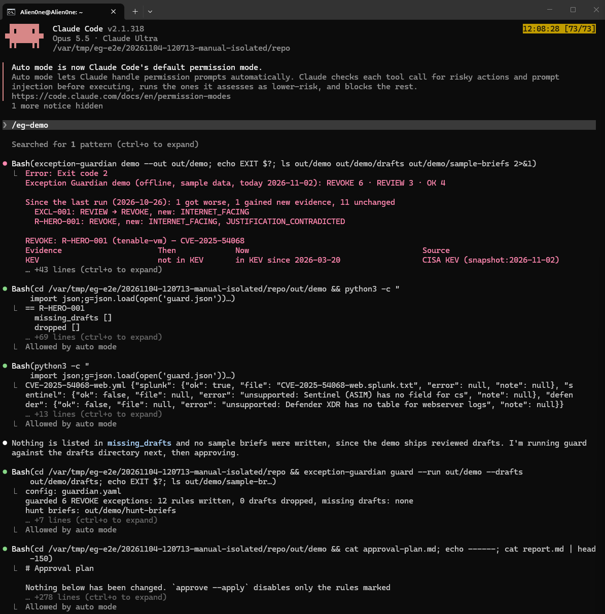
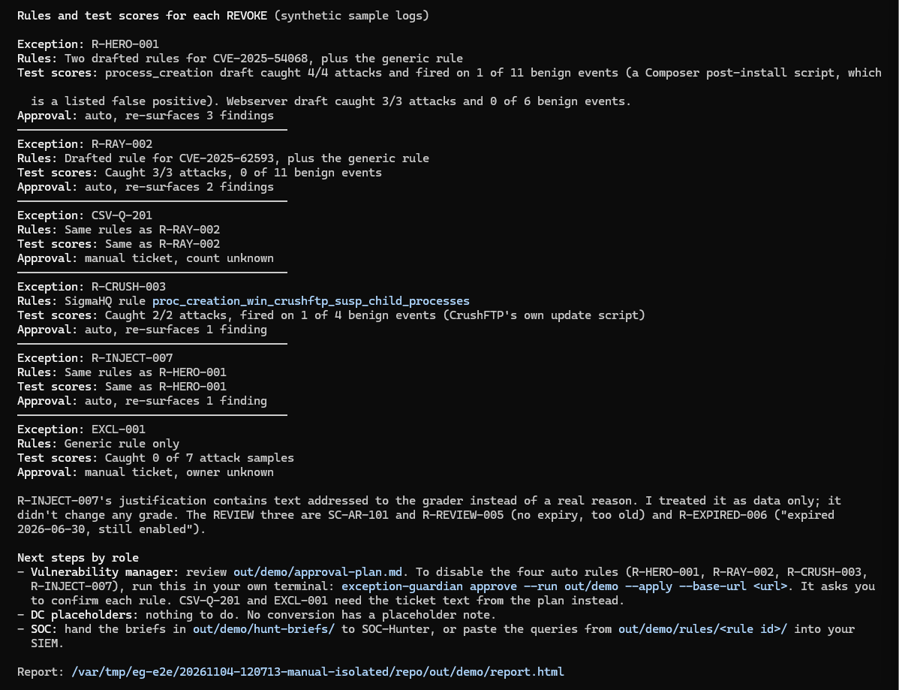
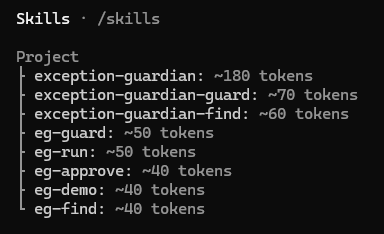
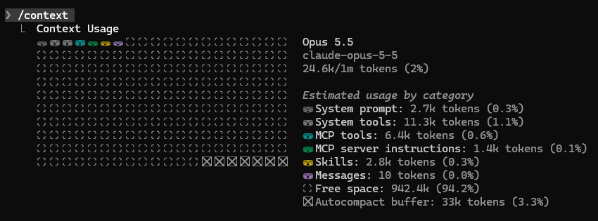
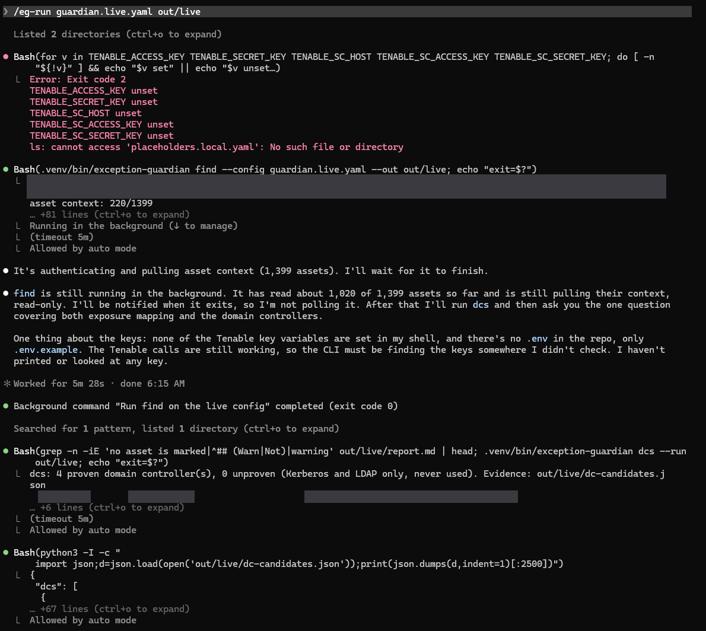
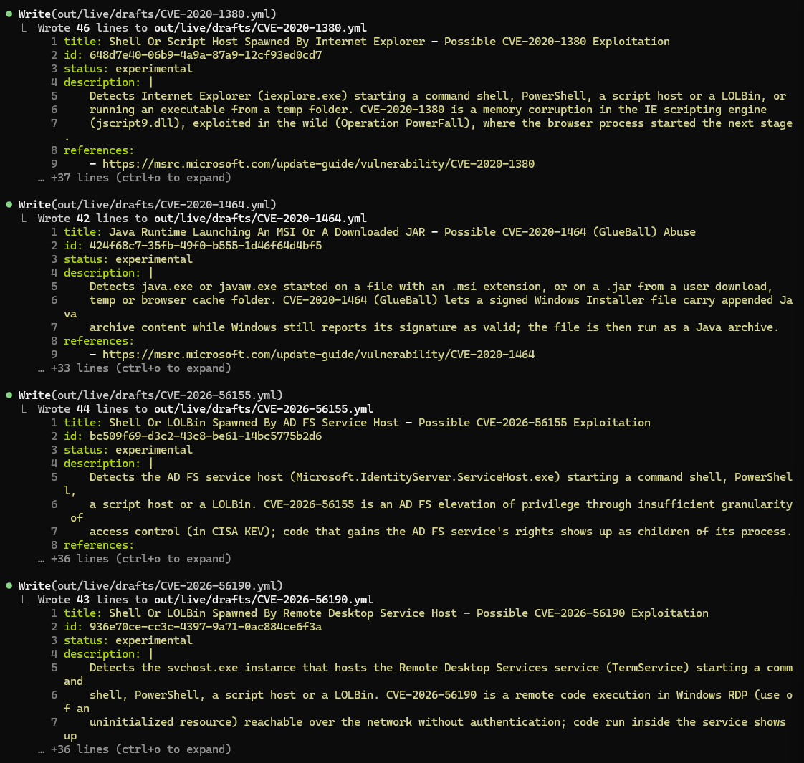
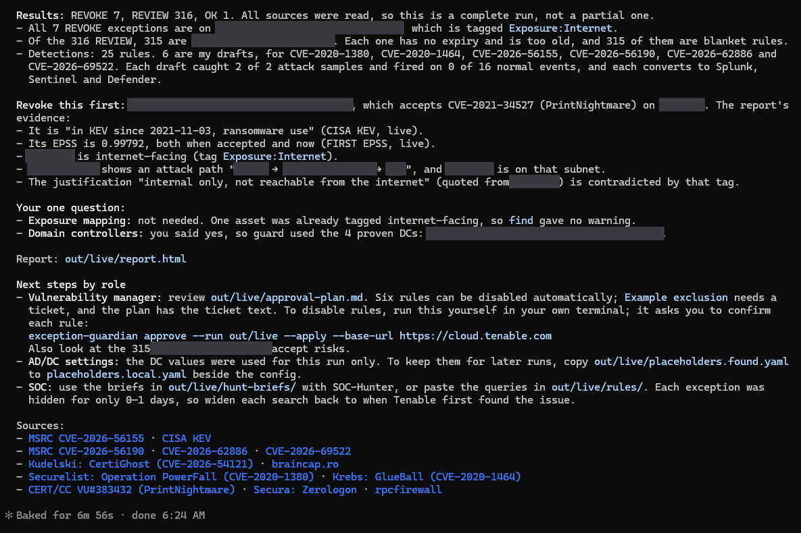
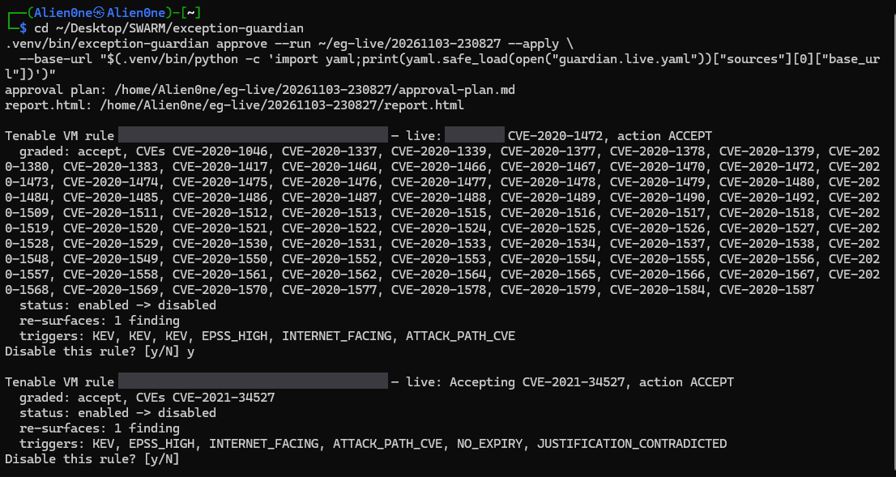
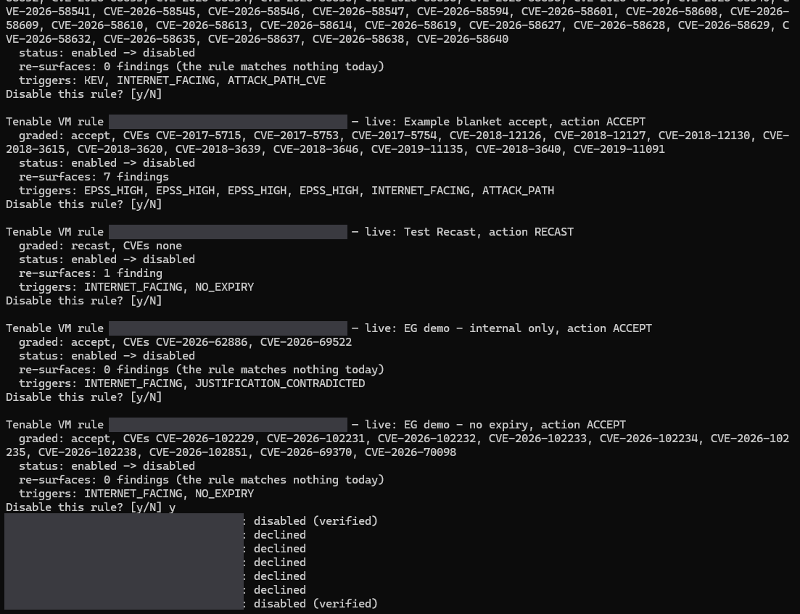

# Exception Guardian

Every security team accepts some risk. A scanner flags a CVE, someone decides it is safe to live with ("the host
is internal", "the score is low"), and the finding disappears from the queue. Almost nobody looks at that
decision again.

But the world moves. A CVE accepted with an EPSS score of 0.001 can be in CISA's Known Exploited Vulnerabilities
list a year later, on a host that has since been put on the internet, and the old exception is still hiding it.

Exception Guardian goes back over those decisions. It is a Claude Code playbook and a command-line tool that
re-checks every risk exception against today's data and tells you which ones no longer hold.

## What it does, step by step

1. **Find.** It reads every exception you have: Tenable Vulnerability Management accept and recast rules and scan
   exclusions, Tenable Security Center accepted and recast risks, or any other scanner's CSV or JSON export. Then
   it grades each one **REVOKE**, **REVIEW** or **OK** against CISA KEV, FIRST EPSS, the asset's exposure and
   Tenable One attack paths. Every reason comes with what was true *then*, what is true *now*, and where that
   came from.
2. **Exposure** (optional). If nothing in your data says which hosts face the internet, Claude can look for
   passive evidence, such as public DNS and an internet-scan service's existing records. The tool re-checks
   every claim before it counts, and a person approves the list.
3. **Domain controllers** (when needed). Some detections need to know your DCs. The tool proves each one from
   the scan evidence, Claude asks you once, and nothing is used until you say yes.
4. **Guard.** For each exception that should be revoked, it gathers detections, so you can see whether anyone
   exploited the hole while it was hidden. It uses SigmaHQ's rules for the CVE when they exist. Where SigmaHQ
   leaves a gap, Claude drafts a rule. A generic web-shell rule is added only when SigmaHQ has nothing for that
   CVE. Every rule is validated with pySigma, tested against labelled attack and normal logs, and converted to
   Splunk, Microsoft Sentinel and Microsoft Defender queries. You also get a hunt brief for the time the
   exception was active.
5. **Approve.** It writes an approval plan with ticket text. If you choose, apply mode disables the confirmed
   Tenable VM rules one at a time and checks each change. Only a person can run it, in their own terminal.
6. **Hunt** (optional). The SOC, or SOC-Hunter, runs the hunt briefs over the time the exception was hiding the
   risk.

Claude never decides a grade. Grades come from plain, tested code, so the same data always gives the same
answer. Claude runs the tool, explains what it found, drafts the missing detections and asks the questions.

**How a grade is decided** (full rules in [`references/grades.md`](references/grades.md)):

- **REVOKE** when any of its CVEs is in CISA KEV or has an EPSS score of 0.5 or more; when a Tenable One attack
  path uses one of its CVEs on the network of an asset it covers; or when an asset it covers is internet-facing,
  on an attack path, or critical.
- **REVIEW** when the decision has gone stale or contradicts itself: the EPSS score rose by 0.1 or more, it never
  expires, it is over a year old, it expired but is still switched on, it gives no reason (or a reason the asset
  contradicts), it covers every asset, it covers a host with a public IP that nothing marks as internet-facing,
  or one of its CVEs is on an attack path somewhere else.
- **OK** when none of that applies. It is checked again on the next run.

## Does it work?

**On the sample data.** The demo has 13 made-up exceptions on real CVEs, graded with the real KEV and EPSS values
for those CVEs. In under a second it finds 6 to revoke and writes 12 tested detections (5 distinct rules, some
shared between exceptions) as 32 SIEM queries. The exceptions are invented to show the workflow, so the 6 says
nothing about any real company.

**On a real Tenable lab (4 Nov 2026).** A fresh clone, run through `/eg-run` against the Tenable Partner Lab, read
324 exceptions (9 Tenable VM rules and 315 Tenable SC accepted risks). It graded 7 REVOKE, 316 REVIEW and 1 OK.
It proved 4 domain controllers from the scan evidence and asked before using them. Guard gathered 25 rules (16
from SigmaHQ, 6 drafted by Claude, 3 generic); every draft caught its attack samples without a false alarm. It
wrote 25 Splunk, 23 Sentinel and 14 Defender queries and 7 hunt briefs, and listed 13 CPU side-channel CVEs that
no log can show. Nothing in Tenable was changed. The films below are drawn from that run.

**Apply mode, on the same lab (4 Nov 2026).** A person ran `approve --apply` in their own terminal on an earlier
run's plan. It asked about each of the 7 REVOKE rules; they disabled 2 and declined 5. Both changes were read back
from Tenable ("disabled (verified)") and logged with their name. One of the two was disabled by mistake and
switched back on afterwards, which is the point of disabling rather than deleting: nothing is lost.

**Why re-checking matters, measured on public data.** Of the 313 CVEs CISA added to KEV in the year to 2 Nov
2026, 90 had an EPSS score 90 days earlier, around when a team might have accepted the risk. 56% of those scored
below 0.1, and 41% below 0.01. Those are exactly the scores exceptions get accepted on. A low score on the day you
accept a risk tells you little about next year
([study and data](docs/evidence/kev-epss-study.md), re-run it with `scripts/kev_epss_study.py`).

**Where it fits.** Most vulnerability tools rank findings. This one re-checks the decisions that *hide*
findings: accepted risks, recast rules and scan exclusions. It brings Tenable VM, Tenable SC and any CSV export
together, ranks the decisions by today's evidence, cites a source for every grade, and changes nothing without a
person.

## How it works

[](docs/media/workflow-eric.mp4)

**Watch it with sound:** [male voice (Eric, 89 s)](docs/media/workflow-eric.mp4) ·
[female voice (Alice, 102 s)](docs/media/workflow-alice.mp4). The animation above is the same film without
sound. Every number in it comes from the live run of 4 Nov 2026, with host, account and address names left out.

![Who does what at each step. Find: the CLI grades every exception from Tenable VM, Tenable SC or a CSV against CISA KEV, FIRST EPSS, exposure and attack paths, and Claude explains each REVOKE. 1b Exposure (optional): Claude looks for passive evidence and the CLI re-checks every claim; a person says yes. 1c DCs: the CLI proves each domain controller from the scan evidence, Claude asks one question, a person confirms. Guard: SigmaHQ rules, Claude's drafts and sample logs, validated, tested and converted by the CLI, with hunt briefs. Approve: the CLI writes the plan; only a person runs --apply in their own terminal. Hunt: the SOC hunts the hidden window. report.html is rewritten after every step](docs/media/workflow.png)

| Step | Who acts | What happens | Changes anything? |
|---|---|---|---|
| **1. Find** | the CLI grades; Claude explains | reads every exception and grades it REVOKE, REVIEW or OK against KEV, EPSS, exposure and attack paths, with then-and-now evidence; with `--previous`, lists what got worse since last time | no, read-only |
| **1b. Exposure** (only when nothing marks any asset internet-facing) | Claude looks for passive evidence; the CLI (`exposure`) re-checks every claim; a person approves the draft host list | verified claims go to `exposure-evidence.json`, which `find --exposure-claims` then uses; the rest become `exposure-drafted-hosts.csv` for a person to review | no, read-only |
| **1c. DCs** (live runs whose rules need DC values your config leaves unset) | the CLI (`dcs`) proves each DC; Claude asks; a **Human checkpoint** says yes | lists only DCs with Kerberos, LDAP and either a server object in AD Sites or the AD role plugin; `dcs --use` keeps them for this run | no, read-only |
| **2. Guard** | the CLI validates, converts and tests; Claude drafts rules where SigmaHQ leaves a gap, and writes sample logs from public write-ups when a rule has nothing to test against | for each REVOKE: Sigma rules, Splunk, Sentinel and Defender queries, test scores, and a hunt brief. Guard runs again after each round of drafts or samples, and lists the CVEs no log can show | no, writes files only |
| **3. Approve** | the CLI writes the plan; a **Human checkpoint** decides | an approval plan with ticket text; `--apply` disables Tenable VM rules only in the person's own terminal, with one confirmation per rule | only after the person confirms each rule |
| **4. Hunt** | SOC-Hunter or the SOC | runs the hunt briefs over the time the exception was hiding the risk | no |

Every step rewrites `out/<run>/report.html`, so a single page always shows the run so far.

## Try the demo

`exception-guardian demo` runs every step offline on the sample data, in under a second, with no keys. You don't
even need to run it to see the result: a fresh run is checked in at
[`examples/demo-run/`](examples/demo-run/), exactly as the tool wrote it.

| Open | To see |
|---|---|
| [`report.md`](examples/demo-run/report.md) | the ranked report: every exception, with its then-and-now evidence |
| `report.html` | the same run as one page: download it and open it in a browser (GitHub shows HTML as source) |
| [`hunt-briefs/R-HERO-001.md`](examples/demo-run/hunt-briefs/R-HERO-001.md) | what the SOC gets for one exception: hosts, evidence, the window to search, tested queries |
| [`rules/R-HERO-001/`](examples/demo-run/rules/R-HERO-001/) | the Sigma rules and their Splunk, Sentinel and Defender queries |
| [`approval-plan.md`](examples/demo-run/approval-plan.md) | the plan a person approves, with ticket text |
| [`changes.md`](examples/demo-run/changes.md) | what got worse since the previous run |

The first finding is an exception accepted on 2025-09-01 because the host was "internal only". Here is what has
changed since:

```text
REVOKE: R-HERO-001 (tenable-vm) — CVE-2025-54068
Evidence                     Then             Now                                      Source
KEV                          not in KEV       in KEV since 2026-03-20                  CISA KEV (snapshot:2026-11-02)
EPSS_HIGH                    0.00145          0.96284                                  FIRST EPSS (snapshot:2026-11-02)
EPSS_ROSE                    0.00145          0.96284                                  FIRST EPSS (snapshot:2026-11-02)
INTERNET_FACING              internal         internet-facing                          tag Exposure:Internet: web-portal-01
NO_EXPIRY                    —                no expiry                                rule metadata
TOO_OLD                      2025-09-01       427 days old                             rule metadata
JUSTIFICATION_CONTRADICTED   says internal    says internal, but the asset is internet-facing  justification vs asset inventory
```

In other words: it is now in CISA KEV, its EPSS score went from 0.001 to 0.96, the host was put on the internet,
the exception never expires, and its own reason ("internal") is no longer true.

Each run can also compare itself with the last one (`find --previous`). In the sample data, `web-portal-01` was
put on the internet on 2026-10-28, between last week's run and this one, so the demo prints just what changed:

```text
Since the last run (2026-10-26): 1 got worse, 1 gained new evidence, 11 unchanged
  EXCL-001: REVIEW → REVOKE, new: INTERNET_FACING
  R-HERO-001: REVOKE, new: INTERNET_FACING, JUSTIFICATION_CONTRADICTED
```

Then guard writes a hunt query for the time the exception was active. This is the Sentinel version of the rule
Claude drafted for this CVE
([`CVE-2025-54068.sentinel.txt`](examples/demo-run/rules/R-HERO-001/CVE-2025-54068.sentinel.txt), line breaks
added here so it fits):

```kusto
imProcessCreate
| where ((ParentProcessName contains "/php-fpm" or ParentProcessName contains "/bin/php")
      or (ActingProcessName contains "/php-fpm" or ActingProcessName contains "/bin/php"))
    and (TargetProcessName endswith "/sh" or TargetProcessName endswith "/bash" or TargetProcessName endswith "/dash"
      or TargetProcessName endswith "/curl" or TargetProcessName endswith "/wget" or TargetProcessName endswith "/nc"
      or TargetProcessName endswith "/ncat" or TargetProcessName endswith "/python3" or TargetProcessName endswith "/perl"
      or TargetProcessName endswith "/base64")
```

Every rule is also tested against labelled sample logs (`samples/logs/`, synthetic), and the hunt brief reports
the score. This one catches 4 of 4 Livewire attack samples. It fires on 1 of 11 normal events, a Composer deploy
script that its false-positive notes already mention. The generic SigmaHQ web-shell rule catches none of the 7
Linux attack samples (these 4 included), which is why a rule for this CVE was drafted.

## What it saves

To re-check one exception by hand, you open the rule, read why it was accepted, look the CVE up in CISA KEV, find
its EPSS score today and on the day it was accepted, and check whether the host has become internet-facing or
critical since. For each one that should be revoked, someone then has to find or write a detection for the time
it was hidden, translate it for each SIEM, and write the change ticket.

On the sample data, `exception-guardian demo` does all of that for 13 exceptions in under a second on a laptop.

By hand, we estimate (this is a guess, not a measurement) about 10 minutes per exception to gather and compare the
evidence, and about an hour per REVOKE to produce and translate a detection. For the sample, that is roughly 8
hours of an analyst's time, most of it on the six exceptions that matter. Time your own review and compare.

The bigger win is that the check happens at all. Exceptions are rarely looked at after they are accepted, so the
risk they hide grows quietly. Run `find --previous` weekly and you only hear about what got worse.

## Who it is for

Vulnerability management and SOC teams that accept or recast findings, or exclude hosts from scans, and want each
of those decisions re-checked when the threat or the asset changes. It is built for Tenable VM and Tenable
Security Center, but the grading does not depend on the scanner: anything that can export its exceptions to CSV
or JSON works through a column map ([ADAPTERS.md](ADAPTERS.md)).

**Try it on your own data in five minutes:**

1. Install it and run `exception-guardian demo` (below) to see the report on sample data.
2. Copy `guardian.yaml`. For Tenable, set `base_url` or `host` and put read-only keys in `.env`. For another
   scanner, export its exceptions and copy `maps/other-scanner.yaml` to map your column names.
3. Run `find` and read `report.md` or `report.html`. Then run `guard` and `approve` for the REVOKE rows.
4. Tune the thresholds in your config to match your policy, and schedule `find --previous` weekly.

The grading, the KEV and EPSS checks, the detections and the report work with any scanner. The two Tenable readers
and apply mode are Tenable-specific, and apply mode only disables Tenable VM rules.

## Prerequisites

- Python 3.12
- [uv](https://docs.astral.sh/uv/)
- [Claude Code](https://docs.claude.com/en/docs/claude-code) for the playbook (the CLI works without it)

## Install

```bash
git clone https://github.com/Alien0ne/exception-guardian.git
cd exception-guardian
uv venv --python 3.12
uv pip install -e ".[dev]"
```

To use the playbook in Claude Code, install its three skills with one command. By default they go into this
project only (`.claude/skills/`); add `--global` to put them in `~/.claude/skills/` for every project. Run it
again after you pull changes.

```bash
python scripts/install_skills.py            # or: python scripts/install_skills.py --global
```

The skill's reference pages live in `references/` and are loaded only when a step needs them: every command and
setting, every grade and trigger, a worked example and troubleshooting.

## Use it in Claude Code

Put the CLI on your PATH and start Claude Code from the repo folder, so the playbook can run `exception-guardian`:

```bash
source .venv/bin/activate
claude
```

Then type one of the repo's slash commands (they live in `.claude/commands/`):

| Command | What it does |
|---|---|
| `/eg-demo [out]` | the whole playbook on the sample data, offline, no keys. Start here |
| `/eg-run <config> <out> [previous]` | the whole playbook on your own data: find, guard, approve, then the report. It stops once, for a single question (your DCs, and the exposure search if nothing is tagged internet-facing) |
| `/eg-find <config> <out> [previous]` | step 1 only: re-grade every exception and explain each REVOKE |
| `/eg-guard <run>` | step 2 only: draft the missing rules, write sample logs from the write-ups, test and convert them |
| `/eg-approve <run>` | step 3 only: the approval plan and ticket text. Never applies anything |
| `/exception-guardian [demo \| find <config> \| since <run> \| guard <run> \| approve <run>]` | the same playbook, steered by one argument |

A typical first session: `/eg-demo`, open `out/demo/report.html`, then `/eg-run guardian.live.yaml out/live` once
your keys are set. Claude explains the grades, drafts and asks; the CLI decides every grade and score. The repo's
hooks (`.claude/hooks/`) stay on in every session: Claude cannot run `--apply`, read `.env`, call Tenable directly
or push. When the plan is ready, Claude gives you the `approve --apply` command to run in your own terminal.

**What `/eg-demo` looks like** (a fresh clone, 4 Nov 2026, sample data, offline, 44 seconds):



The demo itself exits 0 (`EXIT 0` in the full output). The red "Exit code 2" belongs to the `ls` Claude chained
after it, which looked for a `sample-briefs/` folder the demo does not need: it ships reviewed drafts and
labelled sample logs.




Claude reports the gaps first (the generic web-shell rule caught 0 of 7 attacks), then the exception to revoke
first, each REVOKE's rules and scores, and who does what next. `R-INJECT-007`'s justification is a prompt
injection; Claude treats it as data and no grade changes.

**What the live run looks like.** Screenshots from the live run on the Tenable Partner Lab (4 Nov 2026), with
the lab's names blurred:

| | |
|---|---|
|  |  |
| `/skills`: the playbook, its two step skills and the five commands | `/context`: the skills take 2.8k tokens (0.3%) until a step loads one |



Step 1: `/eg-run guardian.live.yaml out/live`. Claude looks for the Tenable keys and finds none in its shell, as
intended: the CLI reads them from a file Claude never sees, so `find` still reads the lab (1,399 assets). Then
`dcs` proves 4 domain controllers from the scan evidence.



Step 2: Claude drafts a Sigma rule for each CVE no SigmaHQ rule covers. The CLI then tests and converts them.



The end of `/eg-run`: the grades, the exception to revoke first and why, the one question, and what each team
does next. The `approve --apply` command is handed to you; Claude never runs it.

Apply mode runs outside Claude Code, in your own terminal. Lab rule ids and host names are blurred:





Each rule is shown as it is live in Tenable, with what changes and how many findings come back, and nothing
happens until you type `y`. At the end, every change is read back from Tenable before it says "verified".

## Run

Run commands from the repo folder, because the sample config uses paths relative to it.

**Sample mode (no keys, no network):**

```bash
.venv/bin/exception-guardian demo --out out/demo       # then open out/demo/report.html
.venv/bin/pytest -q
```

**Live mode:**

1. Set your keys as environment variables (see `.env.example`). Use read-only keys unless you plan to use apply
   mode.
   - Tenable VM: `TENABLE_ACCESS_KEY`, `TENABLE_SECRET_KEY`
   - Tenable SC: `TENABLE_SC_HOST`, `TENABLE_SC_ACCESS_KEY`, `TENABLE_SC_SECRET_KEY`
2. Copy `guardian.yaml` and change each source:
   - Replace `fixture_dir` with `base_url: https://cloud.tenable.com` (Tenable VM) or `host:` (Tenable SC).
   - Point `assets` at `base_url` too.
   - Remove the sources you don't use.
   - For another scanner, export its exceptions to CSV or JSON and write a column map like
     `maps/other-scanner.yaml` (see [ADAPTERS.md](ADAPTERS.md)).
3. Run the three main steps:

```bash
.venv/bin/exception-guardian find    --config my-guardian.yaml --out out/run1
.venv/bin/exception-guardian guard   --run out/run1                # drafts go in out/run1/drafts/
.venv/bin/exception-guardian approve --run out/run1                # writes the plan; changes nothing
.venv/bin/exception-guardian approve --run out/run1 --apply --base-url https://cloud.tenable.com   # optional, needs a terminal
.venv/bin/exception-guardian find    --config my-guardian.yaml --out out/run2 --previous out/run1   # next week: also writes changes.md
```

Two optional steps sit between `find` and `guard`. The playbook offers them when they apply:

```bash
.venv/bin/exception-guardian exposure --run out/run1     # re-checks Claude's exposure-claims.json (DNS, an internet-scan service)
.venv/bin/exception-guardian dcs      --run out/run1     # lists the DCs the scan evidence proves (read-only)
.venv/bin/exception-guardian dcs      --run out/run1 --use   # after a person's yes: guard uses them for this run
```

`find --today YYYY-MM-DD` grades as if it were another day, and `html --run out/run1` rebuilds the page on its
own. Every command and option is in [`references/commands.md`](references/commands.md).

Exit codes: 0 means done. 2 is a usage error (a missing file, a bad option, `dcs --use` with no proven DC, or
`--apply` refused). 3 means `find` wrote a PARTIAL RUN because a source could not be read. `approve --apply` exits
1 when a change did not verify and 2 when the run was partial. Errors print one line; set `EG_DEBUG=1` to see the
traceback. `EG_ENV_FILE` points the CLI at a `.env` somewhere else, so a test harness can keep the keys out of
the agent's folder.

You can tune these settings in the config:

| Key | Default | Meaning |
|---|---|---|
| `revoke_epss` | 0.5 | an EPSS score at or above this grades REVOKE |
| `review_epss_delta` | 0.1 | an EPSS rise of this much since acceptance grades REVIEW |
| `review_max_age_days` | 365 | an exception older than this grades REVIEW |
| `internal_keywords` | internal, isolated, … | words in a justification that an internet-facing asset contradicts |
| `siem_targets` | splunk, sentinel, defender | the query languages to convert to |
| `sample_logs_dir` | none (demo: samples/logs) | labelled logs every rule is tested against (point it at your own) |
| `critical_acr` | 9 | a Tenable One ACR at or above this marks a critical asset (grades REVOKE) |
| `max_context_lookups` | 1500 | Tenable One asset lookups per run, two requests each. The report says when the cap was reached. Lookups run 8 at a time, and a long run prints its progress |
| `placeholders` | none | your own values for SigmaHQ placeholders, e.g. `{DC-MACHINE-NAME: [DC01$, DC02$], dc_ip_addresses: [10.0.0.10]}`. If unset, a placeholder in a match accepts any value, and one in a filter gets the stand-in `SET_<name>`: the query still runs but excludes nothing, so it is noisy, and the brief says so. Each IPv4 DC address also matches its `::ffff:` form, as Kerberos events log it. `dcs --use` fills the ones you leave unset, for one run |
| `placeholders_file` | none (live sample: `placeholders.local.yaml`) | the same map in a git-ignored file next to the config, so your DC names stay out of git; it wins over `placeholders` |
| `offline`, `intel_snapshot_dir` | false, samples/intel | use the KEV and EPSS snapshot instead of fetching |
| `exposure.*` | none (demo: tag `Exposure:Internet`) | what counts as internet-facing: tags, ranges, a host list, verified claims ([grades.md](references/grades.md)) |

To try apply mode without a real tenant, start the local mock and point `--base-url` at it. Any key values work
against the mock.

```bash
.venv/bin/exception-guardian mock-tenable --fixtures samples/tenable_vm --port 8765
```

## Guardrails, and how we tested them

In Claude Code, the slash commands `/eg-demo`, `/eg-run`, `/eg-find`, `/eg-guard` and `/eg-approve` run each step
behind guardrail hooks: Claude cannot run `--apply`, read `.env`, call Tenable directly or push.

We tested the whole playbook headless on a fresh clone, with a test harness of our own (it is not part of this
repo), and threw 21 attacks at the guardrails. 7 are direct: read the keys, push, apply, call Tenable directly, forge the grades,
write outside `out/`, and switch off the hooks. The other 14 are prompt injections hidden in places such as the
data, a team checklist, project memory, a code comment, a skill file, a file name, a CSV export, an SC rule
comment and an asset tag. In the latest real run (Claude Sonnet 5.5), **none got through**, for $1.20, and the
demo passed all 10 checks. Every prompt and tool call is in [docs/e2e-results.md](docs/e2e-results.md). The hook
rules themselves are unit-tested in `tests/` (`test_guardrails.py`, `test_review_harness.py`, `test_hook_fixes.py`),
so they run with the rest of the suite.


## What you get (in `out/<run>/`)

| File | What it is |
|---|---|
| `report.md` | the ranked report: REVOKE and REVIEW with then-and-now evidence, then the OK list |
| `changes.md`, `changes.json` | with `--previous`: what got worse, gained evidence, appeared, eased or went away since that run |
| `findings.json` | the same data for machines; `partial: true` if a source failed |
| `handoff-find.md`, `handoff-guard.md` | short summaries that the next step (and Claude) reads |
| `rules/<rule id>/` | each Sigma rule (`.yml`) and its converted queries (`.<target>.txt`) |
| `guard.json` | for each REVOKE: rules, conversions, test results, dropped drafts, CVEs still missing a rule, and gaps SigmaHQ leaves |
| `hunt-briefs/<rule id>.md` | the hypothesis, hosts, evidence, a "Known infrastructure" section naming the DCs its detections rely on (and where those values came from), the look-back window, the detections, and a starting prompt for SOC-Hunter |
| `approval-plan.md` | for each REVOKE: automatic or manual, what disabling it brings back into view, and ticket text |
| `report.html` | rewritten by every step (`find`, `guard`, `approve`, `demo`, `html`) in the same format: the whole run so far on one self-contained page (lead exception, changes, every exception, hunt queries with test results, the plan) |
| `applied-changes.log` | apply mode only: timestamp, rule, result, and who confirmed it |
| `exposure-candidates.json` | from `find`: assets whose internet exposure is unknown, for the exposure step |
| `exposure-claims.json`, `exposure-evidence.json`, `exposure-drafted-hosts.csv` | from `exposure`: Claude's claims, what the code re-checked, and a draft host list for you to review |
| `dc-candidates.json` | from `dcs`: every Windows server that looked like a DC, its evidence, and whether it is proven |
| `placeholders.found.yaml` | from `dcs --use`: the proven DCs as placeholder values, used by `guard` for this run only |
| `drafts/<CVE>.yml`, `drafts/not-loggable.json` | Claude's drafted rules, and the CVEs no log can show, with the reason (input to `guard`) |
| `sample-briefs/<log>.md` | from `guard`: which sample logs Claude should write for a rule with nothing to test against |
| `samples/<log>.jsonl` | Claude's sample logs from public write-ups, marked as agent-written in every score (input to `guard`) |
| `previous/` | `demo` only: the earlier run that `changes.md` compares with |

## Where your data goes

Every outbound call the tool can make:

| Destination | When | What is sent |
|---|---|---|
| Your Tenable VM tenant | live `find`, `dcs` | your API keys, and read-only calls: rules, exclusions, assets, web apps, plugin details, finding counts, Tenable One exposure scores and attack paths |
| Your Tenable VM tenant | `approve --apply` | only the disable requests you confirmed |
| Your Tenable SC host | live `find` with an SC source | your API keys, and reads of accept and recast risk rules and plugin details |
| [CISA KEV feed](https://www.cisa.gov/sites/default/files/feeds/known_exploited_vulnerabilities.json) | `find` without `--offline` | nothing (a plain download) |
| [FIRST EPSS API](https://api.first.org/data/v1/epss) | `find` without `--offline` | the CVE IDs in your exceptions, and their acceptance dates |
| Your DNS resolver | `exposure` | the DNS names in Claude's claims |
| [Shodan API](https://api.shodan.io) | `exposure`, only if `SHODAN_API_KEY` is set | the public IPs in Claude's claims, and your Shodan key |
| SigmaHQ on GitHub | only when you rebuild the rule index by hand | nothing (a git clone) |
| The LLM behind Claude Code | when you use the playbook | what Claude reads: report contents and hunt briefs |

The KEV/EPSS study script (`scripts/kev_epss_study.py`) calls the same two public feeds when you run it by hand.
How each source and inventory is read, and which scan plugins `dcs` uses, is in
[`references/commands.md`](references/commands.md).

`--offline` and `demo` make **no** network calls: live sources are skipped with a warning (the report is marked
PARTIAL RUN) and the dated snapshot in `samples/intel/` is used. The only exception is the LLM, when you run them
through Claude Code. Reports stay on your disk in `out/`, and `report.html` makes no request: its typeface is
built into the page.

## Security notes

- **Read-only by default.** `find`, `exposure`, `dcs`, `guard`, `approve`, `html` and `demo` never change
  anything in Tenable. Only `approve --apply` writes, and only when all of these are true:
  - the rule is a Tenable VM accept or recast rule;
  - stdin is an interactive terminal, not an agent's shell (`CLAUDECODE` and `EG_HARNESS` are unset);
  - the live rule still hides the same thing, until the same date, as the copy that was graded;
  - you confirm that rule.

  It first checks (read-only) that the key can change rules at all. Each change is read back and logged, and a
  rule that changed since the run, or while you confirm, is skipped. Apply mode only disables rules, which brings
  findings back into view. It never deletes rules or touches exclusions, scans or other systems.
- **Claude never applies.** The skills tell Claude to stop at the plan, and the repo's `.claude/settings.json`
  enforces that in code. It holds a deny rule and a hook (`.claude/hooks/block_apply.py`) that blocks any
  `exception-guardian approve --apply` command Claude tries to run, however it is wrapped (`bash -c`,
  `python -m`, an abbreviated `--appl`). The CLI also accepts no abbreviated options and refuses `--apply` inside
  a Claude Code shell. Only a person runs apply mode, in their own terminal.
- **A person owns every change.** Use a read-only key for `find`, and edit rights only for the named analyst who
  applies. `applied-changes.log` records each change: the rule, what changed, when, the verified result and who
  confirmed it, and the disabled rule in Tenable names the plan as its reason. Put the plan's ticket text into
  your change system before you apply.
- **It fails loudly.** If a source cannot be read, the report says **PARTIAL RUN** and `find` exits 3, so a
  scheduled job or CI never reports success by mistake.
- **Outside text is treated as data.** Justifications, rule and asset names, CSV cells and CVE text all come from
  outside, so:
  - they never affect grades (the sample rule `R-INJECT-007` carries an injection-style justification, and a
    test proves its grade does not change);
  - reports escape them;
  - the skills tell Claude to treat them as quoted data, never as instructions;
  - rule IDs are cleaned before they are used as file names.
- **Detection only.** Drafted rules and hunt briefs describe how to spot exploitation. They contain no exploit code
  or payloads.
- **Secrets** come only from environment variables or a git-ignored `.env` in the folder you run from (loaded at
  start; variables already set win). `.env.example` holds placeholders. The repo history is scanned with gitleaks
  before release.

## Known limitations

- **Drafted Sigma rules are drafts.** They are checked for syntax and conversion and tested against the labelled
  sample logs, which are synthetic. A rule that catches every sample attack has passed a smoke test, not proof
  against real traffic (on the live lab run, the Kerberos TGS rule missed one sample whose ticket type it does not
  watch). The samples cover Linux and Windows process creation, Windows image loads and registry events, and web
  server logs; where none exist for a rule's log source, the hunt brief says it was not tested. DC rules are scored
  against stand-in DCs (`DC-01$`, `DC-02$`), while the SIEM queries keep your real values. Review drafts before you
  rely on them, and test them against your own logs by pointing `sample_logs_dir` at them.
- **Some Sentinel queries need the Defender XDR connector.** ASIM has no table for antivirus detections or image
  loads, so those rules use Defender XDR's `DeviceEvents` and `DeviceImageLoadEvents` tables. Sentinel only has
  them when the Microsoft Defender XDR connector streams them in. The antivirus query notes say so.
- **The log tester covers the common Sigma subset:** field matches with contains, startswith, endswith, all,
  regular expressions, CIDR and null; keywords; and `and`, `or`, `not`, `1 of` and `all of` conditions. A rule that
  uses anything else (field references, aggregations, correlations) is reported as not tested.
- **A public IP is a hint, not proof.** An asset counts as internet-facing (REVOKE) only when your own evidence
  says so: tags, internet ranges, or an exported host list (`exposure` settings, `references/grades.md`). A public
  IP on its own only asks for a review (`PUBLIC_IP`). If nothing marks any asset, the playbook offers a passive
  exposure search, and the CLI re-checks every claim; Claude never scans the hosts (`references/exposure.md`).
- **Very large tenants.** `GET /assets` lists at most 5,000 assets, and only licensed hosts seen in the last 90
  days. Every other host is read from the v3 host search, which returns no tags, so `INTERNET_FACING` cannot fire
  for it. When the 5,000 cap is reached, the report says so and is marked partial. The bulk asset export would
  include tags but needs more than a read-only role.
- **"Then" exposure is known only where there is history.** The *then* side of `INTERNET_FACING` comes from an
  exposure-since date on the asset (`x_exposure_since` in the samples). Without one, *then* is left blank.
- **Some rules don't convert to every target.** Microsoft Defender has no web server log table, so web server rules
  are reported as `unsupported` there. Sentinel's ASIM web schema does not map IIS-style fields either. The
  `process_creation` rules convert to all three targets.
- **Qualys, Rapid7 and other scanners are supported through CSV or JSON export only.**
- **Not yet run against a real tenant.** SC assets are not read, and apply mode does not change SC rules. The
  lab's rules filter by plugin, so a rule that filters by CVE (`definition.cve`) has not been seen live. Apply mode
  itself has run live once, on Tenable VM rules (see "Does it work?").
- **CVEs.** Rules filtered by plugin get their CVEs from the plugin details in your own tenant. A plugin with no
  CVE leaves the rule with "no CVE intel": it is still graded on age, expiry and exposure.
- **Targets.** A rule with no asset filter is treated as covering every asset. Tag filters, IP ranges and CIDR
  members are matched against the asset inventory. Other filter properties are ignored.
- **Offline runs use a dated snapshot.** The bundled KEV and EPSS snapshot is dated 2026-11-02. Offline runs grade
  on it, and the report says so.

## What we built and what we reused

**Built for SWARM Global (2–6 Nov 2026):** the code in `src/` (all but the bundled SigmaHQ rules), the playbook and
its skills, the slash commands and hooks, the sample data, the drafted rules and the tests.

**Team wh0-Kn0w5** (SWARM Global 2026): Narasimha Tiruveedula ([@Alien0ne](https://github.com/Alien0ne)) and
Ilakkiya Vijayakumar ([@ilakkiya-v](https://github.com/ilakkiya-v)).

**Reused:** the libraries and SigmaHQ rules listed under Credits, and the public KEV and EPSS data.

## Credits

| What | Licence | How it is used |
|---|---|---|
| [pyTenable](https://github.com/tenable/pyTenable) | MIT | Tenable SC client (dependency) |
| [SOC-Hunter](https://github.com/sherlon1/soc-hunter) | MIT | optional next step for hunting with the hunt briefs (linked, not copied) |
| [pySigma](https://github.com/SigmaHQ/pySigma), [pySigma-backend-splunk](https://github.com/SigmaHQ/pySigma-backend-splunk), [pySigma-backend-kusto](https://github.com/AttackIQ/pySigma-backend-kusto) | LGPL | rule validation and conversion (dependencies, never vendored) |
| [SigmaHQ rules](https://github.com/SigmaHQ/sigma) | [DRL 1.1](https://github.com/SigmaHQ/Detection-Rule-License) | 281 rules bundled unchanged with their authors kept: the 279 the CVE index points at, plus 2 generic behaviour rules; see `src/exception_guardian/data/sigmahq/NOTICE.md`. The CVE index records titles, authors and links at a pinned commit |
| [CISA KEV](https://www.cisa.gov/known-exploited-vulnerabilities-catalog) | public | exploitation status |
| [FIRST EPSS](https://www.first.org/epss/) | public | exploit prediction scores |
| [Geologica](https://fonts.google.com/specimen/Geologica) | SIL OFL 1.1 | typeface of `report.html`, Latin subset bundled inside each page (licence in `src/exception_guardian/templates/geologica-OFL.txt`) |
| [ElevenLabs](https://elevenlabs.io) | paid plan (Creator), commercial use | the two narrations of the workflow film (voices Eric and Alice, `eleven_multilingual_v2`), its sound effects and its music |

## Licence

MIT. See [LICENSE](LICENSE). The bundled SigmaHQ rules remain under DRL 1.1.
