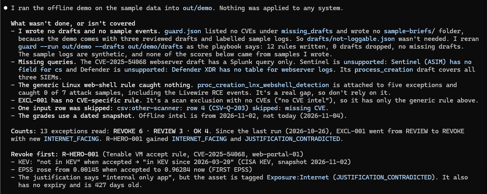

# Exception Guardian

Every security team accepts some risk. A scanner flags a CVE, someone decides it is safe to live with ("the host
is internal", "the score is low"), and the finding disappears from the queue. Almost nobody looks at that
decision again.

But the world moves. A CVE accepted with an EPSS score of 0.001 can be in CISA's Known Exploited Vulnerabilities
list a year later, on a host that has since been put on the internet, and the old exception is still hiding it.

Exception Guardian goes back over those decisions. It is a Claude Code playbook and a command-line tool that
re-checks every risk exception against today's data and tells you which ones no longer hold.

## What it does, step by step

1. **Find.** It reads every exception you have: Tenable Vulnerability Management accept and recast rules and scan
   exclusions, Tenable Security Center accepted and recast risks, or any other scanner's CSV or JSON export. Then
   it grades each one **REVOKE**, **REVIEW** or **OK** against CISA KEV, FIRST EPSS, the asset's exposure and
   Tenable One attack paths. Every reason comes with what was true *then*, what is true *now*, and where that
   came from.
2. **Exposure** (optional). If nothing in your data says which hosts face the internet, Claude can look for
   passive evidence, such as public DNS and an internet-scan service's existing records. The tool re-checks
   every claim before it counts, and a person approves the list.
3. **Domain controllers** (when needed). Some detections need to know your DCs. The tool proves each one from
   the scan evidence, Claude asks you once, and nothing is used until you say yes.
4. **Guard.** For each exception that should be revoked, it gathers detections, so you can see whether anyone
   exploited the hole while it was hidden. It uses SigmaHQ's rules for the CVE when they exist. Where SigmaHQ
   leaves a gap, Claude drafts a rule. A generic web-shell rule is added only when SigmaHQ has nothing for that
   CVE. Every rule is validated with pySigma, tested against labelled attack and normal logs, and converted to
   Splunk, Microsoft Sentinel and Microsoft Defender queries. You also get a hunt brief for the time the
   exception was active.
5. **Approve.** It writes an approval plan with ticket text. If you choose, apply mode disables the confirmed
   Tenable VM rules one at a time and checks each change. Only a person can run it, in their own terminal.
6. **Hunt** (optional). The SOC, or SOC-Hunter, runs the hunt briefs over the time the exception was hiding the
   risk.

Claude never decides a grade. Grades come from plain, tested code, so the same data always gives the same
answer. Claude runs the tool, explains what it found, drafts the missing detections and asks the questions.

**How a grade is decided** (full rules in [`references/grades.md`](references/grades.md)):

- **REVOKE** when any of its CVEs is in CISA KEV or has an EPSS score of 0.5 or more; when a Tenable One attack
  path uses one of its CVEs on the network of an asset it covers; or when an asset it covers is internet-facing,
  on an attack path, or critical.
- **REVIEW** when the decision has gone stale or contradicts itself: the EPSS score rose by 0.1 or more, it never
  expires, it is over a year old, it expired but is still switched on, it gives no reason (or a reason the asset
  contradicts), it covers every asset, it covers a host with a public IP that nothing marks as internet-facing,
  or one of its CVEs is on an attack path somewhere else.
- **OK** when none of that applies. It is checked again on the next run.

## Does it work?

**On the sample data.** The demo has 13 made-up exceptions on real CVEs, graded with the real KEV and EPSS values
for those CVEs. In under a second it finds 6 to revoke and writes 12 tested detections (5 distinct rules, some
shared between exceptions) as 32 SIEM queries. The exceptions are invented to show the workflow, so the 6 says
nothing about any real company.

**On a real Tenable lab (4 Nov 2026).** A fresh clone, run through `/eg-run` against the Tenable Partner Lab, read
324 exceptions (9 Tenable VM rules and 315 Tenable SC accepted risks). It graded 7 REVOKE, 316 REVIEW and 1 OK.
It proved 4 domain controllers from the scan evidence and asked before using them. Guard gathered 25 rules (16
from SigmaHQ, 6 drafted by Claude, 3 generic); every draft caught its attack samples without a false alarm. It
wrote 25 Splunk, 23 Sentinel and 14 Defender queries and 7 hunt briefs, and listed 13 CPU side-channel CVEs that
no log can show. Nothing in Tenable was changed. The films below are drawn from that run.

**Apply mode, on the same lab (4 Nov 2026).** A person ran `approve --apply` in their own terminal on an earlier
run's plan. It asked about each of the 7 REVOKE rules; they disabled 2 and declined 5. Both changes were read back
from Tenable ("disabled (verified)") and logged with their name. One of the two was disabled by mistake and
switched back on afterwards, which is the point of disabling rather than deleting: nothing is lost.

**Why re-checking matters, measured on public data.** Of the 313 CVEs CISA added to KEV in the year to 2 Nov
2026, 90 had an EPSS score 90 days earlier, around when a team might have accepted the risk. 56% of those scored
below 0.1, and 41% below 0.01. Those are exactly the scores exceptions get accepted on. A low score on the day you
accept a risk tells you little about next year
([study and data](docs/evidence/kev-epss-study.md), re-run it with `scripts/kev_epss_study.py`).

**Where it fits.** Most vulnerability tools rank findings. This one re-checks the decisions that *hide*
findings: accepted risks, recast rules and scan exclusions. It brings Tenable VM, Tenable SC and any CSV export
together, ranks the decisions by today's evidence, cites a source for every grade, and changes nothing without a
person.

## How it works

[](docs/media/workflow-eric.mp4)

**Watch it with sound.** The animation above is the same film without sound. Every number in it comes from the
live run of 4 Nov 2026, with host, account and address names left out.

Male voice (Eric, 89 s):

https://github.com/user-attachments/assets/2189797c-c339-4ebe-936e-5e7055d3c12f

Female voice (Alice, 102 s):

https://github.com/user-attachments/assets/64de2b09-94d9-479b-8610-755c0fe23506

To download them: [Eric](docs/media/workflow-eric.mp4), [Alice](docs/media/workflow-alice.mp4).

![Who does what at each step. Find: the CLI grades every exception from Tenable VM, Tenable SC or a CSV against CISA KEV, FIRST EPSS, exposure and attack paths, and Claude explains each REVOKE. 1b Exposure (optional): Claude looks for passive evidence and the CLI re-checks every claim; a person says yes. 1c DCs: the CLI proves each domain controller from the scan evidence, Claude asks one question, a person confirms. Guard: SigmaHQ rules, Claude's drafts and sample logs, validated, tested and converted by the CLI, with hunt briefs. Approve: the CLI writes the plan; only a person runs --apply in their own terminal. Hunt: the SOC hunts the hidden window. report.html is rewritten after every step](docs/media/workflow.png)

| Step | Who acts | What happens | Changes anything? |
|---|---|---|---|
| **1. Find** | the CLI grades; Claude explains | reads every exception and grades it REVOKE, REVIEW or OK against KEV, EPSS, exposure and attack paths, with then-and-now evidence; with `--previous`, lists what got worse since last time | no, read-only |
| **1b. Exposure** (only when nothing marks any asset internet-facing) | Claude looks for passive evidence; the CLI (`exposure`) re-checks every claim; a person approves the draft host list | verified claims go to `exposure-evidence.json`, which `find --exposure-claims` then uses; the rest become `exposure-drafted-hosts.csv` for a person to review | no, read-only |
| **1c. DCs** (live runs whose rules need DC values your config leaves unset) | the CLI (`dcs`) proves each DC; Claude asks; a **Human checkpoint** says yes | lists only DCs with Kerberos, LDAP and either a server object in AD Sites or the AD role plugin; `dcs --use` keeps them for this run | no, read-only |
| **2. Guard** | the CLI validates, converts and tests; Claude drafts rules where SigmaHQ leaves a gap, and writes sample logs from public write-ups when a rule has nothing to test against | for each REVOKE: Sigma rules, Splunk, Sentinel and Defender queries, test scores, and a hunt brief. Guard runs again after each round of drafts or samples, and lists the CVEs no log can show | no, writes files only |
| **3. Approve** | the CLI writes the plan; a **Human checkpoint** decides | an approval plan with ticket text; `--apply` disables Tenable VM rules only in the person's own terminal, with one confirmation per rule | only after the person confirms each rule |
| **4. Hunt** | SOC-Hunter or the SOC | runs the hunt briefs over the time the exception was hiding the risk | no |

Every step rewrites `out/<run>/report.html`, so a single page always shows the run so far.

## Try the demo

`exception-guardian demo` runs every step offline on the sample data, in under a second, with no keys. You don't
even need to run it to see the result: a fresh run is checked in at
[`examples/demo-run/`](examples/demo-run/), exactly as the tool wrote it.

| Open | To see |
|---|---|
| [`report.md`](examples/demo-run/report.md) | the ranked report: every exception, with its then-and-now evidence |
| `report.html` | the same run as one page: download it and open it in a browser (GitHub shows HTML as source) |
| [`hunt-briefs/R-HERO-001.md`](examples/demo-run/hunt-briefs/R-HERO-001.md) | what the SOC gets for one exception: hosts, evidence, the window to search, tested queries |
| [`rules/R-HERO-001/`](examples/demo-run/rules/R-HERO-001/) | the Sigma rules and their Splunk, Sentinel and Defender queries |
| [`approval-plan.md`](examples/demo-run/approval-plan.md) | the plan a person approves, with ticket text |
| [`changes.md`](examples/demo-run/changes.md) | what got worse since the previous run |

The [demo walk-through](docs/demo.md) shows the lead exception's evidence table, what changed since last week's run,
the Sentinel hunt query Claude drafted for it and how that rule scored on the sample logs, and what the tool saves
over checking by hand.

## Who it is for

Vulnerability management and SOC teams that accept or recast findings, or exclude hosts from scans, and want each
of those decisions re-checked when the threat or the asset changes. It is built for Tenable VM and Tenable
Security Center, but the grading does not depend on the scanner: anything that can export its exceptions to CSV
or JSON works through a column map ([ADAPTERS.md](ADAPTERS.md)).

**Try it on your own data in five minutes:**

1. Install it and run `exception-guardian demo` (below) to see the report on sample data.
2. Copy `guardian.yaml`. For Tenable, set `base_url` or `host` and put read-only keys in `.env`. For another
   scanner, export its exceptions and copy `maps/other-scanner.yaml` to map your column names.
3. Run `find` and read `report.md` or `report.html`. Then run `guard` and `approve` for the REVOKE rows.
4. Tune the thresholds in your config to match your policy, and schedule `find --previous` weekly.

The grading, the KEV and EPSS checks, the detections and the report work with any scanner. The two Tenable readers
and apply mode are Tenable-specific, and apply mode only disables Tenable VM rules.

## Prerequisites

- Python 3.12
- [uv](https://docs.astral.sh/uv/)
- [Claude Code](https://docs.claude.com/en/docs/claude-code) for the playbook (the CLI works without it)

## Install

```bash
git clone https://github.com/Alien0ne/exception-guardian.git
cd exception-guardian
uv venv --python 3.12
uv pip install -e ".[dev]"
```

To use the playbook in Claude Code, install its three skills with one command. By default they go into this
project only (`.claude/skills/`); add `--global` to put them in `~/.claude/skills/` for every project. Run it
again after you pull changes.

```bash
python scripts/install_skills.py            # or: python scripts/install_skills.py --global
```

The skill's reference pages live in `references/` and are loaded only when a step needs them: every command and
setting, every grade and trigger, a worked example and troubleshooting.

## Use it in Claude Code

Put the CLI on your PATH and start Claude Code from the repo folder, so the playbook can run `exception-guardian`:

```bash
source .venv/bin/activate
claude
```

Then type one of the repo's slash commands (they live in `.claude/commands/`):

| Command | What it does |
|---|---|
| `/eg-demo [out]` | the whole playbook on the sample data, offline, no keys. Start here |
| `/eg-run <config> <out> [previous]` | the whole playbook on your own data: find, guard, approve, then the report. It stops once, for a single question (your DCs, and the exposure search if nothing is tagged internet-facing) |
| `/eg-find <config> <out> [previous]` | step 1 only: re-grade every exception and explain each REVOKE |
| `/eg-guard <run>` | step 2 only: draft the missing rules, write sample logs from the write-ups, test and convert them |
| `/eg-approve <run>` | step 3 only: the approval plan and ticket text. Never applies anything |
| `/exception-guardian [demo \| find <config> \| since <run> \| guard <run> \| approve <run>]` | the same playbook, steered by one argument |

A typical first session: `/eg-demo`, open `out/demo/report.html`, then `/eg-run guardian.live.yaml out/live` once
your keys are set. Claude explains the grades, drafts and asks; the CLI decides every grade and score. The repo's
hooks (`.claude/hooks/`) stay on in every session: Claude cannot run `--apply`, read `.env`, call Tenable directly
or push. When the plan is ready, Claude gives you the `approve --apply` command to run in your own terminal.

Screenshots of `/eg-demo`, a live `/eg-run` on the Tenable Partner Lab and apply mode in a terminal are in
[docs/claude-code.md](docs/claude-code.md). The end of `/eg-demo`:



## Run

Run commands from the repo folder, because the sample config uses paths relative to it.

**Sample mode (no keys, no network):**

```bash
.venv/bin/exception-guardian demo --out out/demo       # then open out/demo/report.html
.venv/bin/pytest -q
```

**Live mode:**

1. Set your keys as environment variables (see `.env.example`). Use read-only keys unless you plan to use apply
   mode.
   - Tenable VM: `TENABLE_ACCESS_KEY`, `TENABLE_SECRET_KEY`
   - Tenable SC: `TENABLE_SC_HOST`, `TENABLE_SC_ACCESS_KEY`, `TENABLE_SC_SECRET_KEY`
2. Copy `guardian.yaml` and change each source:
   - Replace `fixture_dir` with `base_url: https://cloud.tenable.com` (Tenable VM) or `host:` (Tenable SC).
   - Point `assets` at `base_url` too.
   - Remove the sources you don't use.
   - For another scanner, export its exceptions to CSV or JSON and write a column map like
     `maps/other-scanner.yaml` (see [ADAPTERS.md](ADAPTERS.md)).
3. Run the three main steps:

```bash
.venv/bin/exception-guardian find    --config my-guardian.yaml --out out/run1
.venv/bin/exception-guardian guard   --run out/run1                # drafts go in out/run1/drafts/
.venv/bin/exception-guardian approve --run out/run1                # writes the plan; changes nothing
.venv/bin/exception-guardian approve --run out/run1 --apply --base-url https://cloud.tenable.com   # optional, needs a terminal
.venv/bin/exception-guardian find    --config my-guardian.yaml --out out/run2 --previous out/run1   # next week: also writes changes.md
```

Two optional steps sit between `find` and `guard`. The playbook offers them when they apply:

```bash
.venv/bin/exception-guardian exposure --run out/run1     # re-checks Claude's exposure-claims.json (DNS, an internet-scan service)
.venv/bin/exception-guardian dcs      --run out/run1     # lists the DCs the scan evidence proves (read-only)
.venv/bin/exception-guardian dcs      --run out/run1 --use   # after a person's yes: guard uses them for this run
```

`find --today YYYY-MM-DD` grades as if it were another day, and `html --run out/run1` rebuilds the page on its
own. Every command and option is in [`references/commands.md`](references/commands.md).

Exit codes: 0 done, 2 a usage error or a refused `--apply`, 3 a PARTIAL RUN (a source could not be read). The
thresholds (EPSS lines, age, critical ACR, SIEM targets, sample logs, DC placeholders, exposure) are set in the
config. Both, and the local mock API for trying apply mode, are in [docs/configuration.md](docs/configuration.md).

## Safety

- **Read-only by default.** Only `approve --apply` changes Tenable: Tenable VM rules only, in an interactive
  terminal, after you confirm each rule. It only disables rules (never deletes), and reads each change back.
- **Claude never applies.** A deny rule and a hook in `.claude/settings.json` block `approve --apply` from Claude,
  and the CLI refuses it inside a Claude Code shell.
- **It fails loudly.** If a source cannot be read, the report says **PARTIAL RUN** and `find` exits 3.
- **Outside text is data.** Justifications, names and CSV cells never change a grade, and reports escape them.
- **Detection only.** Drafted rules and hunt briefs contain no exploit code or payloads.
- **Secrets** come only from environment variables or a git-ignored `.env`. The history is scanned with gitleaks.
- **Red-teamed.** 21 attacks on the guardrails (7 direct, 14 prompt injections hidden in the data): none got
  through ([results](docs/e2e-results.md)).

Full details, and how the guardrails were tested: [docs/security.md](docs/security.md).

## What you get (in `out/<run>/`)

| File | What it is |
|---|---|
| `report.md` | the ranked report: REVOKE and REVIEW with then-and-now evidence, then the OK list |
| `report.html` | rewritten by every step (`find`, `guard`, `approve`, `demo`, `html`) in the same format: the whole run so far on one self-contained page (lead exception, changes, every exception, hunt queries with test results, the plan) |
| `changes.md`, `changes.json` | with `--previous`: what got worse, gained evidence, appeared, eased or went away since that run |
| `rules/<rule id>/` | each Sigma rule (`.yml`) and its converted queries (`.<target>.txt`) |
| `hunt-briefs/<rule id>.md` | the hypothesis, hosts, evidence, a "Known infrastructure" section naming the DCs its detections rely on (and where those values came from), the look-back window, the detections, and a starting prompt for SOC-Hunter |
| `approval-plan.md` | for each REVOKE: automatic or manual, what disabling it brings back into view, and ticket text |
| `applied-changes.log` | apply mode only: timestamp, rule, result, and who confirmed it |

Every other file (findings.json, guard.json, the exposure and DC files, Claude's drafts and sample logs) is
listed in [docs/outputs.md](docs/outputs.md).

## Where your data goes

Every outbound call the tool can make:

| Destination | When | What is sent |
|---|---|---|
| Your Tenable VM tenant | live `find`, `dcs` | your API keys, and read-only calls: rules, exclusions, assets, web apps, plugin details, finding counts, Tenable One exposure scores and attack paths |
| Your Tenable VM tenant | `approve --apply` | only the disable requests you confirmed |
| Your Tenable SC host | live `find` with an SC source | your API keys, and reads of accept and recast risk rules and plugin details |
| [CISA KEV feed](https://www.cisa.gov/sites/default/files/feeds/known_exploited_vulnerabilities.json) | `find` without `--offline` | nothing (a plain download) |
| [FIRST EPSS API](https://api.first.org/data/v1/epss) | `find` without `--offline` | the CVE IDs in your exceptions, and their acceptance dates |
| Your DNS resolver | `exposure` | the DNS names in Claude's claims |
| [Shodan API](https://api.shodan.io) | `exposure`, only if `SHODAN_API_KEY` is set | the public IPs in Claude's claims, and your Shodan key |
| SigmaHQ on GitHub | only when you rebuild the rule index by hand | nothing (a git clone) |
| The LLM behind Claude Code | when you use the playbook | what Claude reads: report contents and hunt briefs |

The KEV/EPSS study script (`scripts/kev_epss_study.py`) calls the same two public feeds when you run it by hand.
How each source and inventory is read, and which scan plugins `dcs` uses, is in
[`references/commands.md`](references/commands.md).

`--offline` and `demo` make **no** network calls: live sources are skipped with a warning (the report is marked
PARTIAL RUN) and the dated snapshot in `samples/intel/` is used. The only exception is the LLM, when you run them
through Claude Code. Reports stay on your disk in `out/`, and `report.html` makes no request: its typeface is
built into the page.

## Known limitations

- **Drafted Sigma rules are drafts.** They are tested on synthetic sample logs only: a smoke test, not proof
  against real traffic. Review them, and point `sample_logs_dir` at your own logs.
- **Some Sentinel queries need the Microsoft Defender XDR connector** (antivirus and image-load rules).
- **The log tester covers the common Sigma subset.** Rules using anything else are reported as not tested.
- **A public IP is a hint, not proof.** Internet-facing (REVOKE) needs your own evidence; a public IP alone asks
  for a review.
- **Very large tenants.** Past 5,000 assets, hosts come from a search with no tags, and the report says so.
- **"Then" exposure needs history** (an exposure-since date on the asset); without one it is left blank.
- **Some rules don't convert to every target** (Defender has no web server table).
- **Other scanners** are supported through CSV or JSON export only. SC assets are not read, and apply mode
  changes only Tenable VM rules.
- **Offline runs** grade on the bundled KEV and EPSS snapshot dated 2026-11-02.

Every limitation in full, with what was and was not seen live: [docs/limitations.md](docs/limitations.md).

## What we built and what we reused

**Built for SWARM Global (2–6 Nov 2026):** the code in `src/` (all but the bundled SigmaHQ rules), the playbook and
its skills, the slash commands and hooks, the sample data, the drafted rules and the tests.

**Team wh0-Kn0w5** (SWARM Global 2026): Narasimha Tiruveedula ([@Alien0ne](https://github.com/Alien0ne)) and
Ilakkiya Vijayakumar ([@ilakkiya-v](https://github.com/ilakkiya-v)).

**Reused:** the libraries and SigmaHQ rules listed under Credits, and the public KEV and EPSS data.

## Credits

| What | Licence | How it is used |
|---|---|---|
| [pyTenable](https://github.com/tenable/pyTenable) | MIT | Tenable SC client (dependency) |
| [SOC-Hunter](https://github.com/sherlon1/soc-hunter) | MIT | optional next step for hunting with the hunt briefs (linked, not copied) |
| [pySigma](https://github.com/SigmaHQ/pySigma), [pySigma-backend-splunk](https://github.com/SigmaHQ/pySigma-backend-splunk), [pySigma-backend-kusto](https://github.com/AttackIQ/pySigma-backend-kusto) | LGPL | rule validation and conversion (dependencies, never vendored) |
| [SigmaHQ rules](https://github.com/SigmaHQ/sigma) | [DRL 1.1](https://github.com/SigmaHQ/Detection-Rule-License) | 281 rules bundled unchanged with their authors kept: the 279 the CVE index points at, plus 2 generic behaviour rules; see `src/exception_guardian/data/sigmahq/NOTICE.md`. The CVE index records titles, authors and links at a pinned commit |
| [CISA KEV](https://www.cisa.gov/known-exploited-vulnerabilities-catalog) | public | exploitation status |
| [FIRST EPSS](https://www.first.org/epss/) | public | exploit prediction scores |
| [Geologica](https://fonts.google.com/specimen/Geologica) | SIL OFL 1.1 | typeface of `report.html`, Latin subset bundled inside each page (licence in `src/exception_guardian/templates/geologica-OFL.txt`) |
| [ElevenLabs](https://elevenlabs.io) | paid plan (Creator), commercial use | the two narrations of the workflow film (voices Eric and Alice, `eleven_multilingual_v2`), its sound effects and its music |

## Licence

MIT. See [LICENSE](LICENSE). The bundled SigmaHQ rules remain under DRL 1.1.
