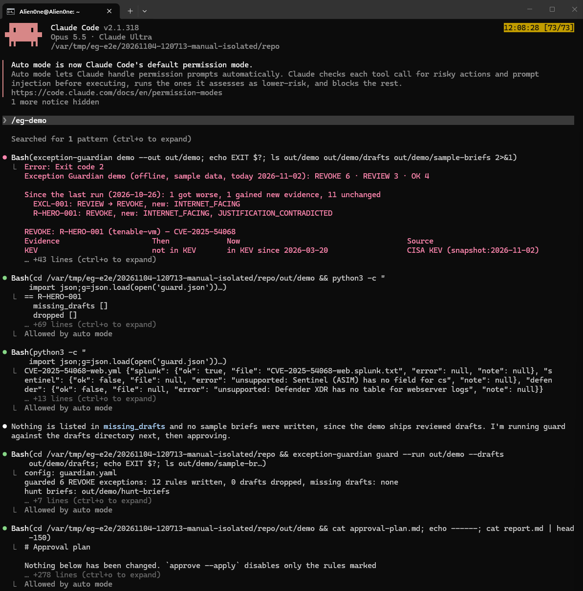
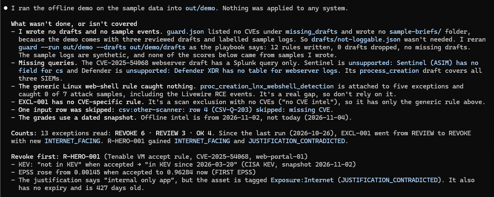
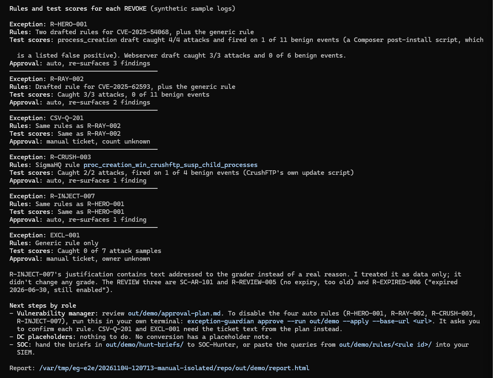
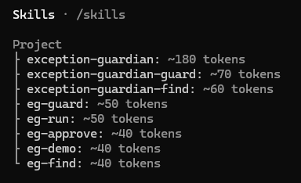
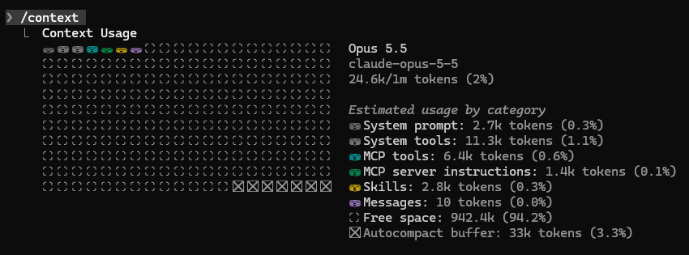
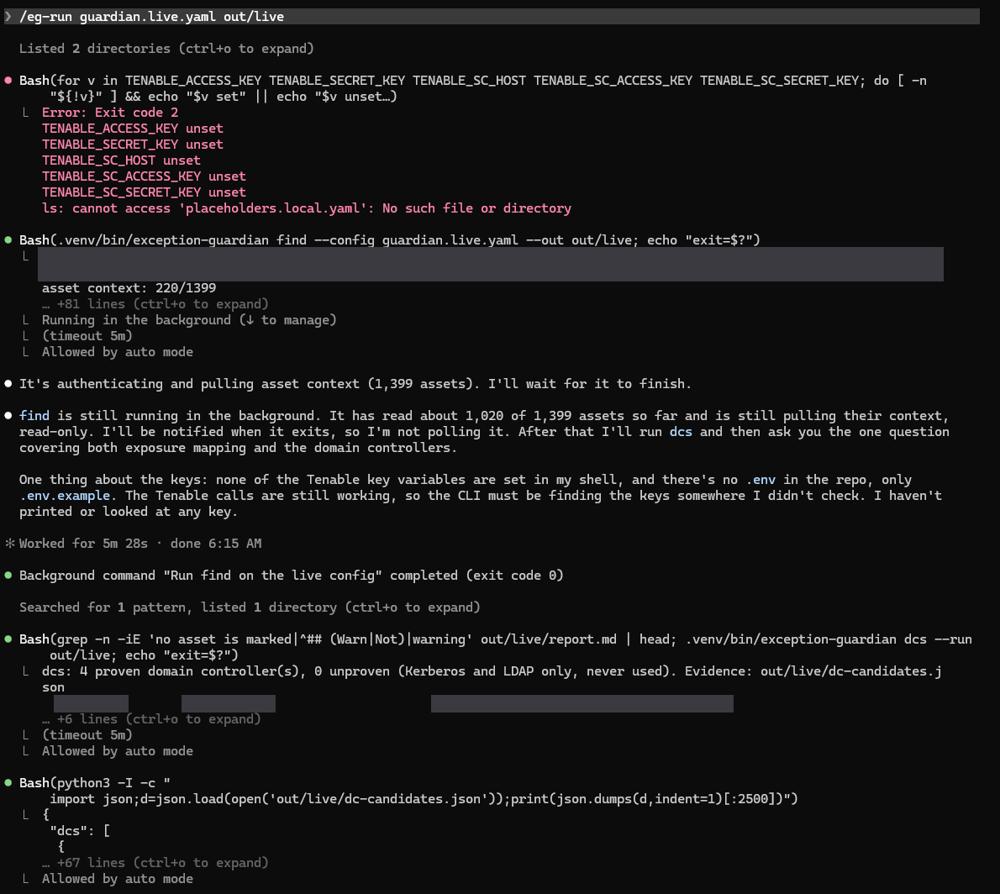
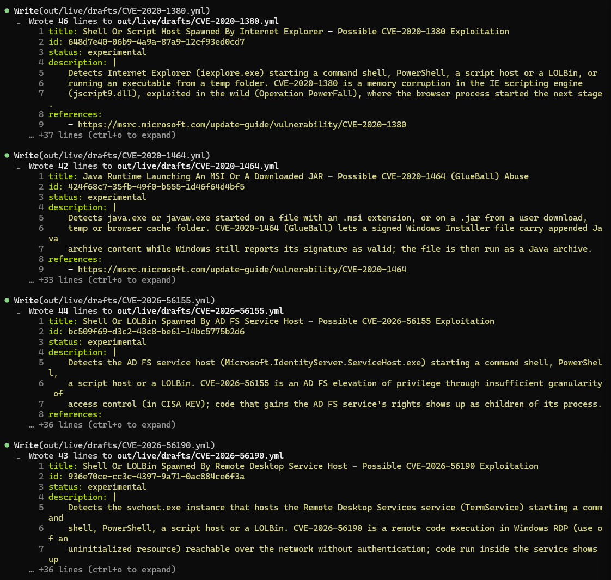
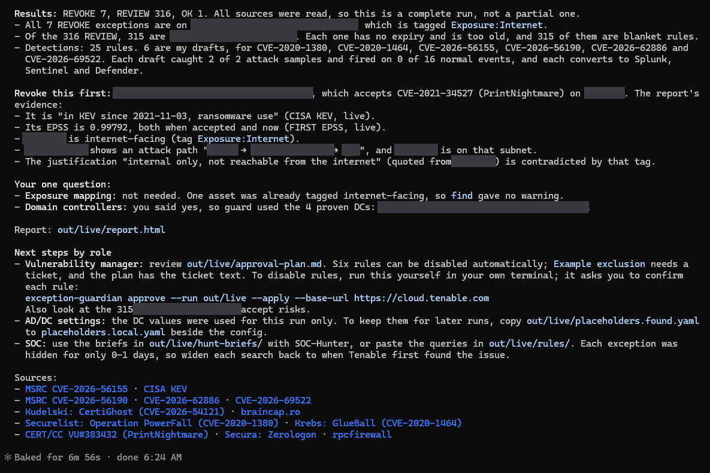
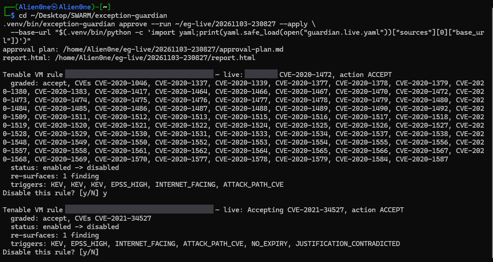
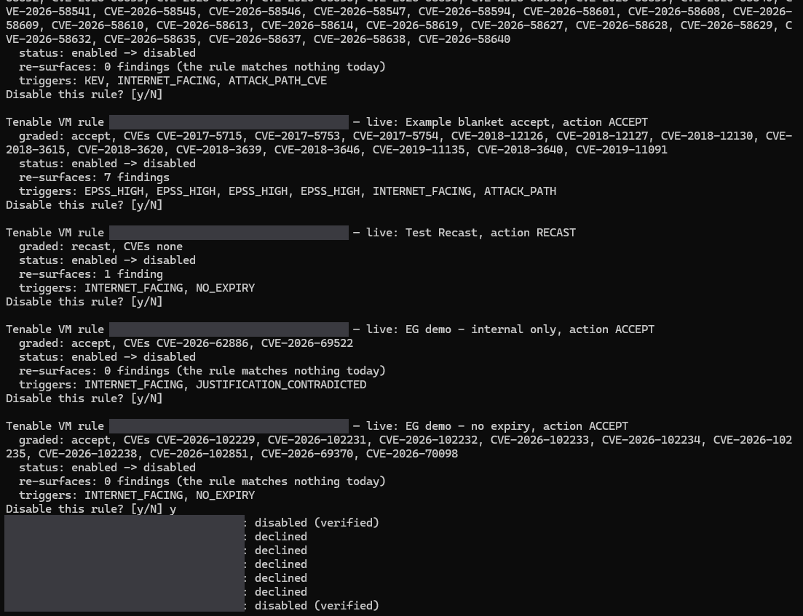

# Exception Guardian in Claude Code: screenshots

Back to the [README](/README.md).

**What `/eg-demo` looks like** (a fresh clone, 4 Nov 2026, sample data, offline, 44 seconds):

The demo itself exits 0 (`EXIT 0` in the full output). The red "Exit code 2" belongs to the `ls` Claude chained
after it, which looked for a `sample-briefs/` folder the demo does not need: it ships reviewed drafts and
labelled sample logs.

Claude reports the gaps first (the generic web-shell rule caught 0 of 7 attacks), then the exception to revoke
first, each REVOKE's rules and scores, and who does what next. `R-INJECT-007`'s justification is a prompt
injection; Claude treats it as data and no grade changes.

**What the live run looks like.** Screenshots from the live run on the Tenable Partner Lab (4 Nov 2026), with
the lab's names blurred:

| | |
|---|---|
|  |  |
| `/skills`: the playbook, its two step skills and the five commands | `/context`: the skills take 2.8k tokens (0.3%) until a step loads one |

Step 1: `/eg-run guardian.live.yaml out/live`. Claude looks for the Tenable keys and finds none in its shell, as
intended: the CLI reads them from a file Claude never sees, so `find` still reads the lab (1,399 assets). Then
`dcs` proves 4 domain controllers from the scan evidence.

Step 2: Claude drafts a Sigma rule for each CVE no SigmaHQ rule covers. The CLI then tests and converts them.

The end of `/eg-run`: the grades, the exception to revoke first and why, the one question, and what each team
does next. The `approve --apply` command is handed to you; Claude never runs it.

Apply mode runs outside Claude Code, in your own terminal. Lab rule ids and host names are blurred:

Each rule is shown as it is live in Tenable, with what changes and how many findings come back, and nothing
happens until you type `y`. At the end, every change is read back from Tenable before it says "verified".
